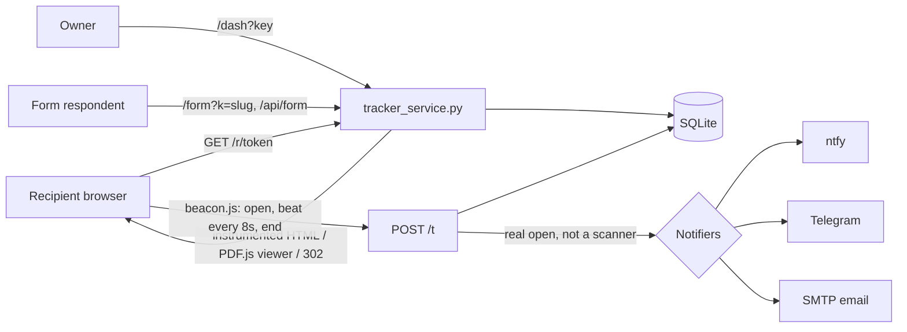

# doc-tracker

A self-hosted, DocSend-style tracker for documents and links. You upload a document (or wrap any URL), mint one link per recipient, and see who opened it, from where, on which device, how far they scrolled and how long they spent on each section or page. Every real open can trigger a push notification.

The whole service is one Python file with no third-party dependencies (`sqlite3` + `http.server` from the standard library), so it runs on any box with Python 3.9+ or on the stock `python:3.12-slim` image without a build step.

## Why

Hosted document-analytics tools are priced per seat and keep your documents and reader data on their servers. This covers the parts I actually used (per-recipient links, read depth, heatmaps, open alerts) in a single process you can run next to your other services. It also deals with a problem the naive version gets wrong: corporate mail gateways and chat link previews open every link before the human does, which produces false "opened" alerts.

## Architecture



- `GET /r/<token>` resolves the recipient link. HTML documents get `beacon.js` and a comment overlay injected; PDFs render in a PDF.js viewer where every page is a tracked section; images get a minimal viewer; URL documents log a click and redirect with `?r=<token>` so an external page that includes `beacon.js` can report dwell data for that same link.
- `beacon.js` sends an `open` event, a heartbeat every 8 seconds while the tab is visible and the user was active in the last 30 seconds, and an `end` event via `sendBeacon` on hide. Payload: max scroll %, furthest section, active ms, per-section dwell, viewport, language, time zone.
- Sections are `[data-track]` elements (falling back to `section[id]`). Pages without sections fall back to one heat row per route, which makes the beacon usable on small multi-page apps.
- Visits are classified at read time as `real`, `thin` (opened, no interaction) or `bot`. Because classification is not stored, rule changes apply retroactively to old data.

## Features

- Four content types: wrapped URL, uploaded HTML, PDF, image.
- Per-recipient links with optional password (salted SHA-256, HMAC-signed unlock cookie).
- Versioning: upload a new file or target URL, old versions and their stats stay selectable.
- Dashboard: per-document and per-recipient section heatmaps, per-visit drill-down, search across names, URLs, recipients and folders, one-level folders, archive (links return 404) and permanent purge.
- Scanner filtering: user-agent patterns (headless browsers, HTTP libraries, link-preview bots, mail-security vendors) plus datacenter ASN names from the geo lookup. A visit with scroll and at least 5 s of activity always counts as real. VPN providers are deliberately not treated as bots.
- Alert de-duplication: one push per visitor and link per 10 minutes, so multi-page sites do not fire once per page load.
- Comment pins: reviewers click anywhere in an HTML document to leave threaded comments; the owner gets a push.
- Questionnaires: autosaving forms (single/multi choice, free text, percentage split) with a submit push and an answers view. See `examples/sample_form.html`.
- JSON endpoints for external monitors and spreadsheet sync (`/api/monitor/activity`, `/api/monitor/links`).
- CLI: `serve`, `docs`, `list`, `add "Name" email doc_id`.

## Stack

Python 3 standard library (`http.server.ThreadingHTTPServer`, `sqlite3` in WAL mode, `urllib`, `smtplib`), vanilla JS for the beacon and dashboard, PDF.js from cdnjs for the PDF viewer, ipwho.is or ipinfo.io for geo/ASN lookups (cached per IP).

## Setup

Local:

```bash
cp .env.example .env        # set TRACKER_KEY at minimum
python3 tracker_service.py serve
# dashboard: http://localhost:8092/dash?key=<TRACKER_KEY>
# sample form: http://localhost:8092/form?k=demo
```

Docker:

```bash
cp .env.example .env
docker compose up -d
```

The compose file binds to `127.0.0.1:8092`; put a TLS-terminating reverse proxy in front and set `TRACKER_BASE_URL` to the public origin. The service reads the client IP from `X-Forwarded-For` / `X-Real-IP`, so make sure only your proxy can reach the port.

Minting a link from the shell:

```bash
curl -X POST "$BASE/admin/doc?key=$KEY" -d '{"name":"Proposal","target":"https://example.com/proposal"}'
curl -X POST "$BASE/admin/link?key=$KEY" -d '{"doc_id":"<id>","name":"Jane Doe","pw":"optional"}'
```

To track an external page you control, add `<script src="https://<tracker-host>/beacon.js"></script>` and share it through a wrapped-URL link.

## Configuration

| Variable | Default | Purpose |
|---|---|---|
| `TRACKER_KEY` | empty | Admin key for `/dash` and `/admin/*`. Empty means open; the server warns at startup. |
| `TRACKER_BASE_URL` | `http://localhost:<port>` | Origin used in minted links and notification click targets. |
| `TRACKER_PORT` / `TRACKER_BIND` | `8092` / `127.0.0.1` | Listen address. Use `0.0.0.0` in containers. |
| `TRACKER_DB` | `./data/tracker.db` | SQLite file. |
| `TRACKER_DOCS` | `<db dir>/docs` | Uploaded files. |
| `TRACKER_BRAND` | `Doc Tracker` | Name shown in the dashboard header. |
| `TRACKER_FORMS` | `demo:sample_form.html:Sample questionnaire` | `slug:file:label` entries separated by `;`. |
| `TRACKER_FORMS_DIR` | `./examples` | Directory for form HTML files. |
| `TRACKER_NOTIFY_OPENS` | `all` | `all`, `named` (only named recipient links) or `off`. Comments, feature requests and form submissions always notify. |
| `NTFY_URL` / `NTFY_TOPIC` / `NTFY_TOKEN` | `https://ntfy.sh` / empty / empty | ntfy push. Disabled while the topic is empty. |
| `TELEGRAM_BOT_TOKEN` / `TELEGRAM_CHAT_ID` | empty | Telegram push with a dashboard button. |
| `TRACKER_ALERT_EMAIL`, `SMTP_HOST`, `SMTP_PORT`, `SMTP_USER`, `SMTP_PASS`, `SMTP_FROM` | empty, `587` | Email alerts. Port 465 uses implicit TLS, others STARTTLS. |
| `IPINFO_TOKEN` | empty | Use ipinfo.io instead of the free ipwho.is endpoint. |
| `TRACKER_ENV_FILE` | `./.env` | Alternative env file path. |

## Limitations

- The admin key travels as a query parameter. Fine behind HTTPS for a single owner, but it ends up in browser history and proxy logs; there are no user accounts or roles.
- Form slugs double as access keys, and the form endpoint has no rate limiting.
- Tracking needs JavaScript. Readers who download a PDF and read it offline, or block scripts, show up as a single thin visit at most.
- Scanner detection is heuristic. A gateway that runs a real browser from a residential IP and scrolls will count as a reader; a reader on a cloud desktop may be flagged at first.
- Geo lookups call a third-party API with the visitor IP. Check whether that fits your privacy obligations and disclose tracking to recipients where required.
- Display times use a built-in Central European time zone (CET/CEST) to avoid a tzdata dependency.
- Single process, single SQLite file. Good for thousands of visits per day, not designed for horizontal scaling.
- The dashboard and its templates are server-rendered strings inside the one file, which keeps deployment trivial but makes UI changes more tedious than with a template engine.

## License

MIT, see [LICENSE](LICENSE).
